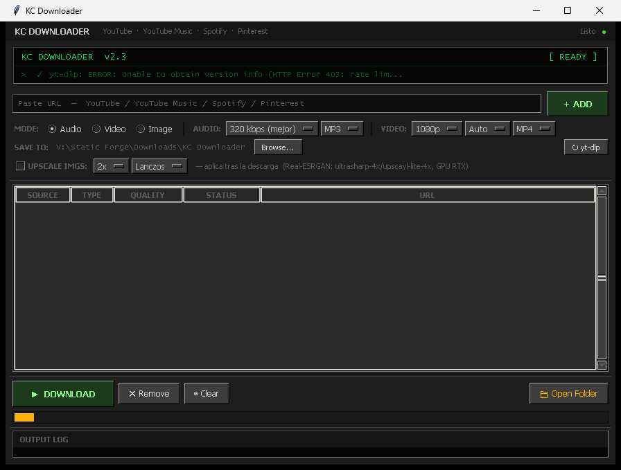
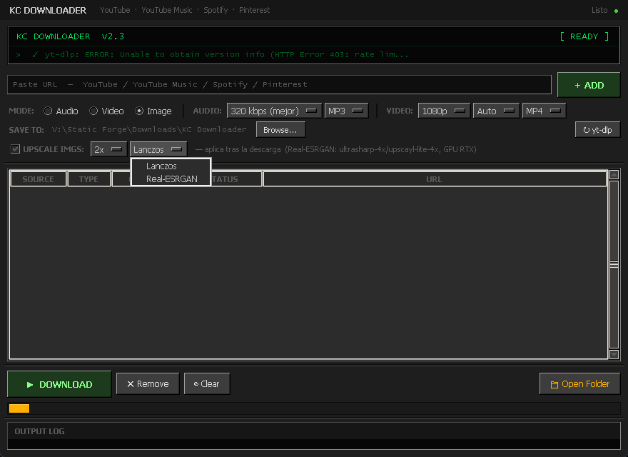

# KC Downloader

**Project page:** [staticforge.me](https://staticforge.me/#proyectos)

## Screenshots



*Winamp-style dark UI: paste a URL, pick audio/video/image, queue and download.*



*Image mode with post-download upscaling (Lanczos or Real-ESRGAN).*

Desktop media downloader for **YouTube**, **YouTube Music**, **Spotify** and **Pinterest**.  
Winamp Classic Dark UI. Goal is zero setup — download the release zip, extract, run.


> ### ⚠️ Known issues (v2.4)
> The app opens and starts, but **downloads currently fail with an error** on both the Windows and Linux builds.
> It has not been verified working on a machine other than the one it was built on — the dependencies are
> bundled, but a clean-machine download has not been confirmed end to end. See [`CHANGELOG.md`](CHANGELOG.md)
> for the full list per release.

## Features

- YouTube & YouTube Music — audio (MP3/WAV/FLAC/OGG) and video (up to 4K)
- Spotify — downloads via spotdl (track / album / playlist)
- Pinterest — images at original resolution + videos; CDN cascade (originals → 736x → 474x)
- Queue system — add multiple URLs, download all at once
- Post-download upscaling — Lanczos or **Real-ESRGAN** (ultrasharp-4x / upscayl-lite-4x)
- Auto-update yt-dlp on startup

## Download & Run

Go to [**Releases**](../../releases) and download the zip for your platform:

| Platform | File |
|---|---|
| Windows 64-bit | `kc-downloader-windows-x64.zip` |
| Linux 64-bit | `kc-downloader-linux-x64.tar.gz` |

**Windows:** extract the zip → double-click `KC Downloader.exe`.  
**Linux:** extract → `chmod +x "KC Downloader" yt-dlp ffmpeg spotdl` → run `./KC\ Downloader`.

yt-dlp, ffmpeg and spotdl are bundled in the zip — no Python or pip install step. See the known
issues above: this currently gets you a working window, not a working download yet.

> **Linux note:** Real-ESRGAN upscaling is not included in the Linux release. Download  
> `realesrgan-ncnn-vulkan` and place it next to the binary if you want it.

## Real-ESRGAN (Windows — included in release)

The Windows zip includes `realesrgan-ncnn-vulkan.exe` and two models in `models/`:
- `ultrasharp-4x` — best quality for photos and wallpapers (4x)
- `upscayl-lite-4x` — faster, lighter model (2x/4x)

Enable it in the app: check **Upscale** → pick **Real-ESRGAN** → choose 2x or 4x.

## Build from source

```bash
pip install yt-dlp spotdl pillow pyinstaller
pyinstaller --onefile --windowed --name "KC Downloader" kc_downloader.py
```

## Stack

Python 3.12 · Tkinter · yt-dlp · spotdl · ffmpeg · Pillow · realesrgan-ncnn-vulkan

---

Made by [Rooty / KCRooty](https://github.com/KCRooty) · [Static Forge](https://github.com/KCRooty)
