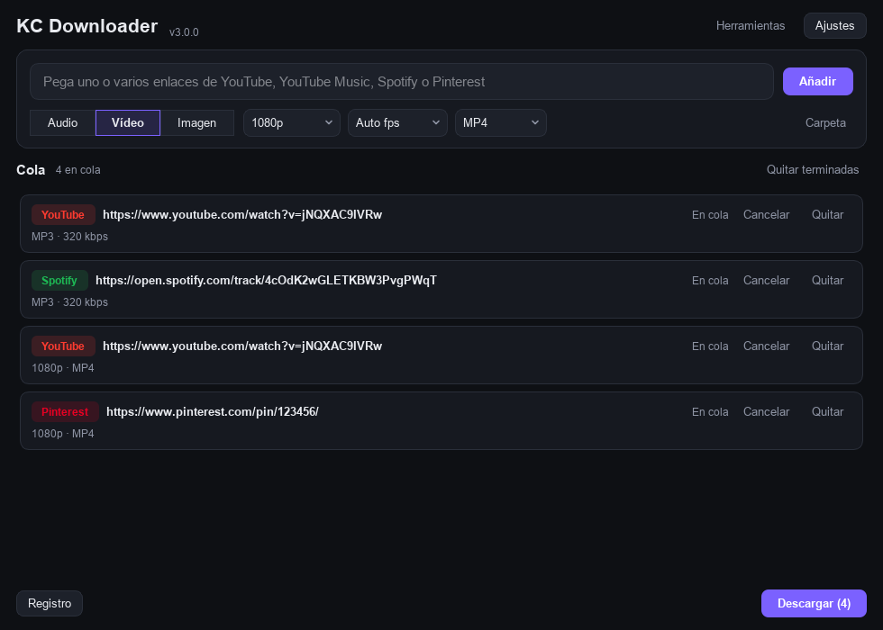
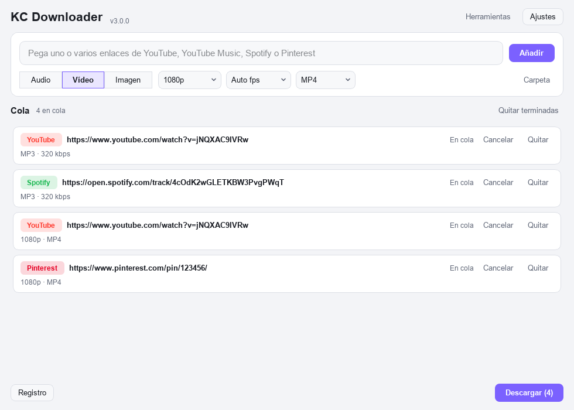
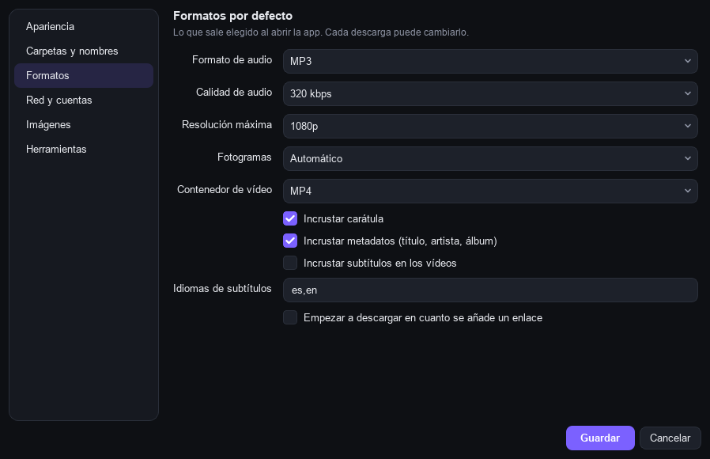
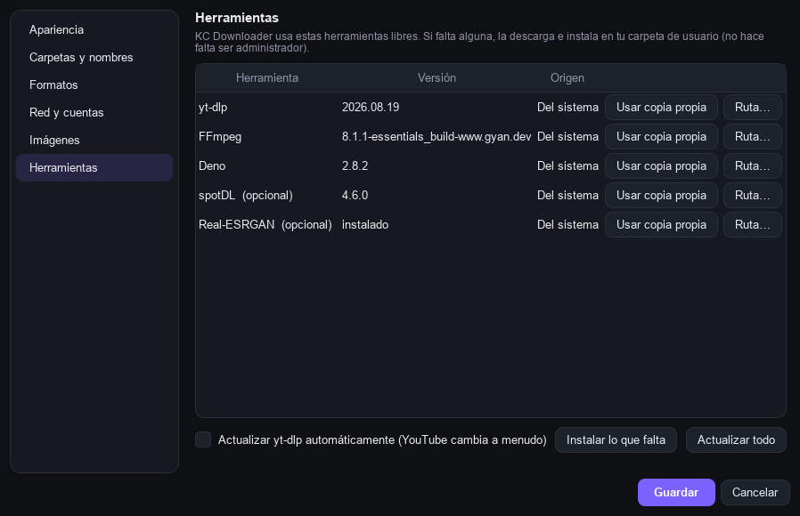

# KC Downloader

**Project page:** [staticforge.me](https://staticforge.me/#proyectos)

Desktop media downloader for **YouTube**, **YouTube Music**, **Spotify** and **Pinterest**.
Download the release, extract, run — the tools it needs come inside.




| Light theme | Settings → Formats | Settings → Tools |
|---|---|---|
|  |  |  |

## Features

- **YouTube & YouTube Music** — audio (MP3, M4A, OPUS, OGG, FLAC, WAV) or video
  (up to max resolution, 30/60 fps, MP4 / MKV / WEBM / MOV), playlists into their own folder.
- **Spotify** — track, album or playlist; each song is fetched from YouTube Music
  with cover and tags. No Spotify account or API key.
- **Pinterest** — images at original size (originals → 736x → 474x) and videos.
- **Queue** — paste or drag many links at once, parallel downloads, progress / speed / ETA,
  retry, cancel, open the file's folder.
- **Image upscaling** — Real-ESRGAN (GPU, Vulkan) or Lanczos, x2 / x3 / x4.
- **Everything configurable** — theme (light / dark / system), accent colour, font size,
  folders and file-name templates, default formats, cookies, proxy, speed limit.
- **Self-managed tools** — installs and updates yt-dlp, FFmpeg and Deno from their
  official releases (SHA-256 checked), no admin rights.

The interface is in Spanish.

## Download & run

Get the archive for your platform from [**Releases**](../../releases):

| Platform | File |
|---|---|
| Windows 10/11 64-bit | `kc-downloader-<version>-windows-x64.zip` |
| Linux 64-bit (glibc 2.30+: Ubuntu 22.04+, Mint 21+, Debian 11+, Fedora, Arch, CachyOS) | `kc-downloader-<version>-linux-x64.tar.gz` |

**Windows:** extract the zip anywhere → open `KC Downloader.exe`.

**Linux:**
```bash
tar xf kc-downloader-*-linux-x64.tar.gz
cd "KC Downloader"
./kc-downloader            # run it
./install.sh               # optional: add it to the applications menu (./install.sh --remove to undo)
```
It runs on X11 and Wayland. It only needs what any desktop distro already has (OpenGL/EGL).

## Tools

KC Downloader drives these free programs:

| Tool | Needed for | Shipped in the release |
|---|---|---|
| yt-dlp | every download | yes |
| FFmpeg | merging, converting, covers | yes |
| Deno | YouTube (JavaScript challenges) | yes |
| Real-ESRGAN | AI upscaling (optional) | yes |
| spotDL | old Spotify fallback (optional) | no |

For each one it uses, in this order: a path you chose → a copy the app installed in your
user folder → the copy shipped next to the executable → whatever is on the system PATH.
**Settings → Tools** shows which one is in use, and installs or updates them.
YouTube changes often: keep "update yt-dlp automatically" on, or press **Update all**
when downloads start failing.

## Where things are saved

| | Windows | Linux |
|---|---|---|
| Settings | `%APPDATA%\KC Downloader\settings.json` | `~/.config/kc-downloader/settings.json` |
| Tools installed by the app, log | `%LOCALAPPDATA%\KC Downloader\` | `~/.local/share/kc-downloader/` |
| Downloads (default) | `Downloads\KC Downloader\{Audio,Vídeo,Imágenes}` | same, under your XDG Downloads folder |

Set `KCDL_HOME=<folder>` to keep settings and tools in one folder (portable mode).

## Build from source

Python 3.12+.

```bash
pip install -r requirements.txt -r requirements-dev.txt
python kc_downloader.py               # run from source
python -m pytest -q tests             # unit tests
python packaging/build.py             # build + bundle tools -> dist/*.zip | dist/*.tar.gz
python packaging/build.py --no-tools  # build without bundling tools
```

On Linux, install the X11 libraries before building so they get bundled:
`libxcb-cursor0 libxcb-icccm4 libxcb-keysyms1 libxcb-shape0 libxcb-image0 libxcb-render-util0 libxkbcommon-x11-0`.

Real downloads test (network): `KCDL_E2E=1 python -m pytest -q tests/test_e2e.py`.

Pushing a `v*` tag runs the GitHub Actions workflow: tests on Windows and Linux, builds both
releases, self-tests the executables and publishes the release with the notes from
[`CHANGELOG.md`](CHANGELOG.md).

## Known issues

See the notes in [`CHANGELOG.md`](CHANGELOG.md). Mainly: Spotify playlists are
capped at about 100 tracks, and Pinterest video and Real-ESRGAN have not been tested end to end yet.

## Stack

Python · PySide6 (Qt 6) · yt-dlp · FFmpeg · Deno · Pillow · Real-ESRGAN ncnn Vulkan · PyInstaller

## License

KC Downloader is free software under the [GNU General Public License v3.0](LICENSE).
The tools it downloads and runs (yt-dlp, FFmpeg, Deno, Real-ESRGAN) keep their own licenses.

---

Made by [Rooty / KCRooty](https://github.com/KCRooty) · [Static Forge](https://github.com/KCRooty)
